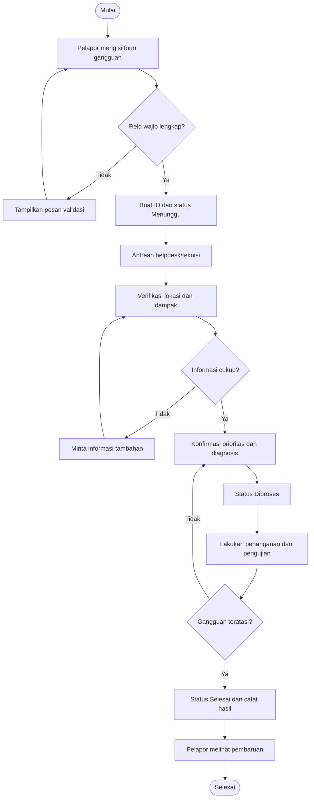
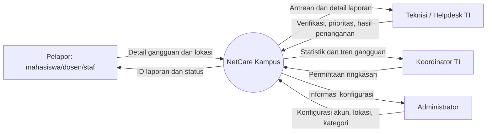

# 4. Model Proses dan Diagram Konteks

## Proses bisnis yang diusulkan

1. Pelapor membuka NetCare Kampus dan memilih menu buat laporan.
2. Pelapor mengisi jenis gangguan, lokasi, dampak, dan deskripsi.
3. Sistem memvalidasi field wajib dan membuat ID serta status Menunggu.
4. Teknisi memeriksa informasi laporan dan memvalidasi dampak/prioritas.
5. Teknisi melakukan diagnosis dan penanganan; status diperbarui menjadi Diproses.
6. Setelah layanan diuji dan dinyatakan pulih, teknisi menutup laporan sebagai Selesai.
7. Pelapor/koordinator melihat status dan ringkasan untuk evaluasi.

## Flow proses laporan

## Diagram konteks

NetCare Kampus diposisikan sebagai satu sistem yang berinteraksi dengan aktor eksternal. Diagram ini menunjukkan rancangan konseptual; backend dan pertukaran data belum diterapkan pada prototipe statis.

## Input, proses, output

| Jenis | Rincian |
|---|---|
| Input | Judul, kategori, lokasi, ruang/titik akses, dampak, deskripsi, identitas kontak opsional |
| Proses | Validasi, pembuatan ID, pengelompokan prioritas, antrean, diagnosis, pembaruan status, agregasi statistik |
| Output | ID laporan, status, daftar/detail laporan, ringkasan berdasarkan status/prioritas, catatan penanganan |

## Kondisi pengecualian yang perlu ditangani

- Form belum lengkap atau deskripsi terlalu pendek.
- Laporan duplikat untuk gangguan yang sama.
- Lokasi/kategori tidak ditemukan dalam daftar.
- Prioritas yang dipilih pelapor tidak sesuai dengan dampak setelah diverifikasi.
- Gangguan belum teratasi dan perlu eskalasi.
- Laporan berisi kredensial atau data sensitif.
- Sistem tidak tersedia; harus ada kanal pelaporan alternatif yang disepakati kampus.

## Status proses

| Status | Makna | Pemilik tindakan |
|---|---|---|
| Menunggu | Laporan sudah tercatat, belum mulai ditangani | Helpdesk/teknisi |
| Diproses | Verifikasi atau penanganan sedang berjalan | Teknisi |
| Selesai | Perbaikan telah diuji dan laporan ditutup | Teknisi |

Status dan aturan transisi di atas merupakan rancangan awal dan perlu disesuaikan dengan SOP unit TI kampus.