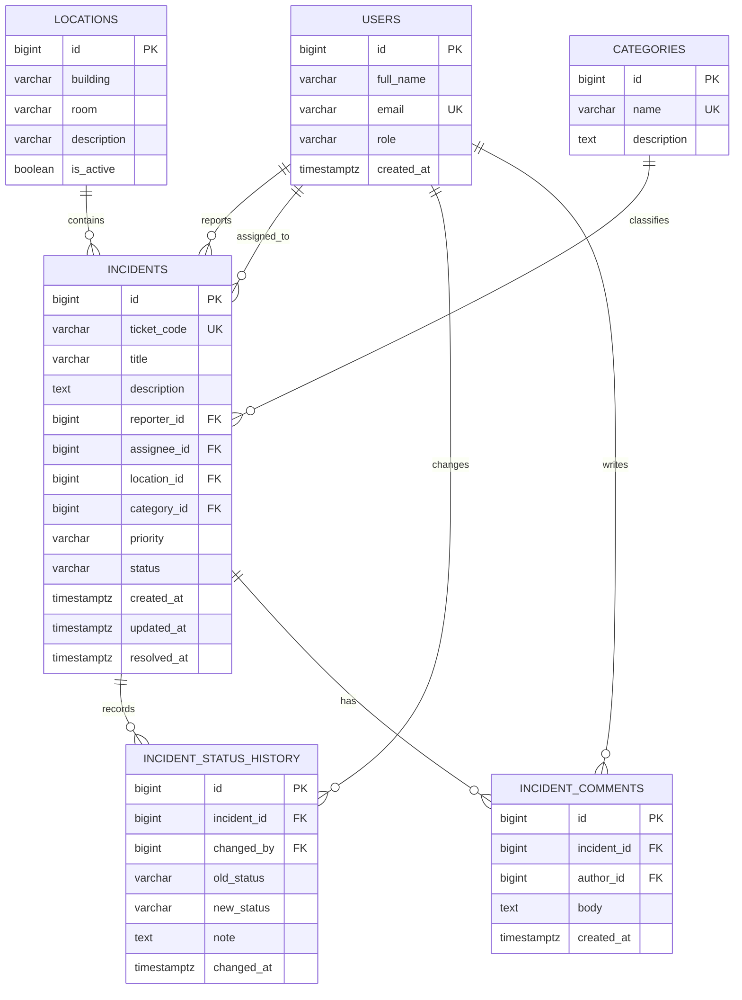

# 5. Desain Basis Data dan Kamus Data

## Entitas utama

- **users**: identitas pengguna dan perannya.
- **locations**: gedung, ruang, atau area yang dipantau.
- **categories**: klasifikasi gangguan.
- **incidents**: data inti laporan gangguan.
- **incident_status_history**: riwayat status untuk audit dan pelacakan.
- **incident_comments**: komunikasi tindak lanjut yang tidak memuat kredensial.

## ERD konseptual



## Kamus data

### Tabel `users`

| Field | Tipe | Kunci | Aturan / arti |
|---|---|---|---|
| id | BIGINT | PK | ID pengguna internal |
| full_name | VARCHAR(120) | — | Nama tampilan |
| email | VARCHAR(254) | UNIQUE | Email akun; wajib pada versi autentikasi |
| role | VARCHAR(20) | — | `reporter`, `technician`, `coordinator`, `admin` |
| created_at | TIMESTAMPTZ | — | Waktu akun dibuat |

### Tabel `locations`

| Field | Tipe | Kunci | Aturan / arti |
|---|---|---|---|
| id | BIGINT | PK | ID lokasi |
| building | VARCHAR(100) | — | Nama gedung/area |
| room | VARCHAR(100) | — | Ruang atau titik akses, boleh kosong |
| description | VARCHAR(255) | — | Keterangan lokasi |
| is_active | BOOLEAN | — | Menandai lokasi yang masih digunakan |

### Tabel `categories`

| Field | Tipe | Kunci | Aturan / arti |
|---|---|---|---|
| id | BIGINT | PK | ID kategori |
| name | VARCHAR(80) | UNIQUE | Wi-Fi, LAN/kabel, internet lambat, koneksi putus, autentikasi, lainnya |
| description | TEXT | — | Penjelasan kategori |

### Tabel `incidents`

| Field | Tipe | Kunci | Aturan / arti |
|---|---|---|---|
| id | BIGINT | PK | ID internal laporan |
| ticket_code | VARCHAR(20) | UNIQUE | Kode publik, misalnya NC-0001 |
| title | VARCHAR(120) | — | Ringkasan gangguan; wajib |
| description | TEXT | — | Detail gejala dan dampak; jangan simpan rahasia |
| reporter_id | BIGINT | FK → users.id | Pelapor |
| assignee_id | BIGINT | FK → users.id | Teknisi yang ditugaskan; nullable |
| location_id | BIGINT | FK → locations.id | Lokasi gangguan |
| category_id | BIGINT | FK → categories.id | Kategori gangguan |
| priority | VARCHAR(10) | — | Kritis, Tinggi, Sedang, Rendah |
| status | VARCHAR(12) | — | Menunggu, Diproses, Selesai |
| created_at | TIMESTAMPTZ | — | Waktu laporan dibuat |
| updated_at | TIMESTAMPTZ | — | Waktu perubahan terakhir |
| resolved_at | TIMESTAMPTZ | — | Waktu selesai; nullable |

### Tabel `incident_status_history`

| Field | Tipe | Kunci | Aturan / arti |
|---|---|---|---|
| id | BIGINT | PK | ID riwayat |
| incident_id | BIGINT | FK → incidents.id | Laporan yang berubah |
| changed_by | BIGINT | FK → users.id | Pengguna yang melakukan perubahan |
| old_status | VARCHAR(12) | — | Status sebelumnya, nullable saat dibuat |
| new_status | VARCHAR(12) | — | Status setelah perubahan |
| note | TEXT | — | Catatan penanganan singkat |
| changed_at | TIMESTAMPTZ | — | Waktu perubahan |

### Tabel `incident_comments`

| Field | Tipe | Kunci | Aturan / arti |
|---|---|---|---|
| id | BIGINT | PK | ID komentar |
| incident_id | BIGINT | FK → incidents.id | Laporan terkait |
| author_id | BIGINT | FK → users.id | Penulis komentar |
| body | TEXT | — | Catatan komunikasi tindak lanjut |
| created_at | TIMESTAMPTZ | — | Waktu dibuat |

## Relasi dan aturan integritas

- Satu pengguna dapat membuat banyak laporan.
- Satu lokasi dan satu kategori dapat dipakai banyak laporan.
- Teknisi dapat ditugaskan ke banyak laporan; penugasan boleh kosong.
- Satu laporan dapat memiliki banyak catatan status dan komentar.
- Penghapusan pengguna/lokasi/kategori yang masih dirujuk perlu dibatasi atau ditangani dengan soft-delete.
- Versi produksi harus menerapkan foreign key, validasi nilai status/prioritas, dan otorisasi berbasis peran di server.

## SQL rancangan (PostgreSQL)

Skema berikut adalah rancangan awal, belum dijalankan pada server database. Sebelum produksi, tinjau kebijakan privasi, indeks, retensi, serta aturan akses.

```sql
CREATE TABLE users (
  id BIGINT GENERATED ALWAYS AS IDENTITY PRIMARY KEY,
  full_name VARCHAR(120) NOT NULL,
  email VARCHAR(254) NOT NULL UNIQUE,
  role VARCHAR(20) NOT NULL CHECK (role IN ('reporter','technician','coordinator','admin')),
  created_at TIMESTAMPTZ NOT NULL DEFAULT now()
);

CREATE TABLE locations (
  id BIGINT GENERATED ALWAYS AS IDENTITY PRIMARY KEY,
  building VARCHAR(100) NOT NULL,
  room VARCHAR(100),
  description VARCHAR(255),
  is_active BOOLEAN NOT NULL DEFAULT TRUE
);

CREATE TABLE categories (
  id BIGINT GENERATED ALWAYS AS IDENTITY PRIMARY KEY,
  name VARCHAR(80) NOT NULL UNIQUE,
  description TEXT
);

CREATE TABLE incidents (
  id BIGINT GENERATED ALWAYS AS IDENTITY PRIMARY KEY,
  ticket_code VARCHAR(20) NOT NULL UNIQUE,
  title VARCHAR(120) NOT NULL,
  description TEXT NOT NULL,
  reporter_id BIGINT NOT NULL REFERENCES users(id) ON DELETE RESTRICT,
  assignee_id BIGINT REFERENCES users(id) ON DELETE SET NULL,
  location_id BIGINT NOT NULL REFERENCES locations(id) ON DELETE RESTRICT,
  category_id BIGINT NOT NULL REFERENCES categories(id) ON DELETE RESTRICT,
  priority VARCHAR(10) NOT NULL CHECK (priority IN ('Kritis','Tinggi','Sedang','Rendah')),
  status VARCHAR(12) NOT NULL DEFAULT 'Menunggu' CHECK (status IN ('Menunggu','Diproses','Selesai')),
  created_at TIMESTAMPTZ NOT NULL DEFAULT now(),
  updated_at TIMESTAMPTZ NOT NULL DEFAULT now(),
  resolved_at TIMESTAMPTZ
);

CREATE TABLE incident_status_history (
  id BIGINT GENERATED ALWAYS AS IDENTITY PRIMARY KEY,
  incident_id BIGINT NOT NULL REFERENCES incidents(id) ON DELETE CASCADE,
  changed_by BIGINT NOT NULL REFERENCES users(id) ON DELETE RESTRICT,
  old_status VARCHAR(12),
  new_status VARCHAR(12) NOT NULL CHECK (new_status IN ('Menunggu','Diproses','Selesai')),
  note TEXT,
  changed_at TIMESTAMPTZ NOT NULL DEFAULT now()
);

CREATE TABLE incident_comments (
  id BIGINT GENERATED ALWAYS AS IDENTITY PRIMARY KEY,
  incident_id BIGINT NOT NULL REFERENCES incidents(id) ON DELETE CASCADE,
  author_id BIGINT NOT NULL REFERENCES users(id) ON DELETE RESTRICT,
  body TEXT NOT NULL,
  created_at TIMESTAMPTZ NOT NULL DEFAULT now()
);

CREATE INDEX idx_incidents_status_priority ON incidents(status, priority);
CREATE INDEX idx_incidents_location_created ON incidents(location_id, created_at DESC);
CREATE INDEX idx_incidents_reporter_created ON incidents(reporter_id, created_at DESC);
CREATE INDEX idx_status_history_incident_time ON incident_status_history(incident_id, changed_at DESC);
```

**Catatan implementasi:** kode tiket perlu dibuat dengan mekanisme yang aman terhadap konkurensi (misalnya sequence/UUID atau fungsi transaksi), bukan sekadar menghitung jumlah laporan. Perubahan status harus ditulis bersama riwayatnya dalam transaksi.